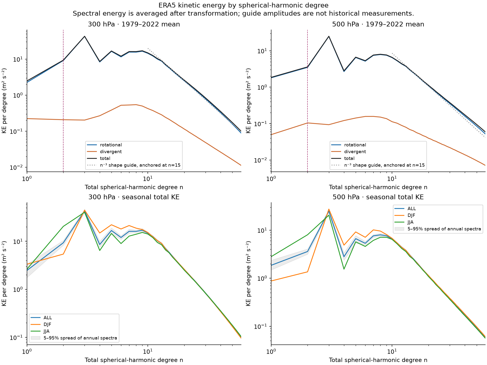

# ERA5 n=2 energy — Unity analysis and historical comparisons

Code, numerical results, figures and reproducibility records for ERA5 spherical-harmonic analysis. All atmospheric processing and numerical tests ran on Unity compute nodes.

**Status: initial comparisons completed; scientific review required.** Six synthetic tests passed. The strict individual-coefficient resolution criterion failed, and the 10-day Madden target did not exceed the chosen background reference. This is a partial comparison, not a certified replication or an automatic pass to further dynamical hypotheses.

## Results

**[Open the visual gallery — all figures, captions and data links](GALLERY.md)**

- **[Madden comparison](results/STAGE1_REPORT.md):** 64,284 six-hourly samples, 1979–2022, at 300 and 500 hPa. The 5-day and 4-day targets show clear westward excess; the 10-day target is weak under this estimator. Includes seasonal spectra and EOF/PC-pair diagnostics.
- **[Energy versus spherical-harmonic degree](results/SPECTRAL_CONTENT_REPORT.md):** rotational, divergent and total KE for n=1–59, seasonal variation, mean-flow/transient partitions, and n=2 content. Includes comparisons with Boer & Shepherd (1983), Nastrom & Gage (1985), and the UKMO spectra in Koshyk & Hamilton (2001).
- **[Setup and numerical checks](results/SETUP_REPORT.md):** tests, energy closure, grid-resolution audit and pilot timings.
- **[Numerical degree spectra](results/energy_degree_spectra.csv)** and **[run records](results/job-accounting.tsv)**.
- **[Data archives](https://github.com/npizzo/n2-era5-madden/releases):** all extracted coefficient files, divergent-energy files, historical-window data, fine-grid sensitivity data and pilot data. Checksums are under results/.



The historical comparison checks spectral shape and scale dependence. Historical spectral amplitudes were not digitized. The ERA5 July 1993–1997, 92–353 hPa comparison uses the same months, years and an approximate pressure layer as the UKMO benchmark; its total-KE slope over n=10–20 is −2.836. The current n≤59 grid does not resolve the aircraft mesoscale −5/3 range.

The all-season 300 hPa spectrum has E₁=2.471, E₂=9.317 and E₃=42.840 m² s⁻². Thus n=2 is below n=3 but is not a local minimum relative to both adjacent degrees. These values alone do not diagnose condensation or a nonlinear energy cascade.

## Methods and scope

Read the [methodology and deviations](docs/methods.md). The supplied [original plan](docs/original_plan.md) is preserved as reference material. This is an ERA5 comparison with Madden, whose original data and EOF-based estimator differed. The degree-spectrum comparison was added at the user's request. Pattern-speed, nonlinear-transfer and forecast experiments have not been run.

The six synthetic tests cover the transform round trip, solid-body rotation, energy closure, physical westward-wave FFT sign, seasonal gaps and annual-cycle fitting. Real-data energy closure passed at approximately machine precision. Whole-field resolution differences were 0.38–0.53%, but individual small coefficients exceeded 1%; the failed strict criterion remains visible. A complete 1979 1° sensitivity run found target-mode westward PSD differences of about 0.09–0.40% between the two grids, without proving full-record convergence.

## Reproduce on Unity

Project directory: `/work/pi_nicholas_pizzo_uri_edu/n2-era5-madden`.

```bash
mkdir -p logs results data
sbatch slurm/prepare.sbatch
# After setup succeeds:
sbatch slurm/validate.sbatch
# After reviewing validation, run the mode-specific resolution audit:
sbatch slurm/resolution.sbatch
# Then extract the full record:
extract_id=$(sbatch --parsable slurm/extract.sbatch)
fine_id=$(sbatch --parsable --dependency=afterok:$extract_id slurm/fine.sbatch)
sbatch --dependency=afterok:$fine_id slurm/analyze.sbatch
# Companion energy-content comparison:
div_id=$(sbatch --parsable slurm/divergent.sbatch)
hist_id=$(sbatch --parsable slurm/historical.sbatch)
sbatch --dependency=afterok:$div_id:$hist_id:$extract_id slurm/energy_analysis.sbatch
```

The extraction arrays use six concurrent tasks, one per year. Existing raw outputs are protected against overwriting; resume by submitting missing years only. These jobs are intended for a new output directory, not blind reruns over completed files. Environment requirements are in environment.yml; the tested Linux dependency lock is in results/environment-explicit.txt. Restore that exact environment with `conda create --prefix .env --file results/environment-explicit.txt` on compatible hardware.

`slurm/package.sbatch` and `slurm/package_energy.sbatch` create the release archives after their respective analyses finish. Source hashes, data hashes, environment details and Slurm accounting accompany the reports. No raw gridded ERA5 data or credentials are stored in Git.

## Sources

- [Madden (2007)](https://doi.org/10.1111/j.1600-0870.2007.00257.x), Tellus A 59, 571–590.
- [WeatherBench 2 ERA5 data guide](https://weatherbench2.readthedocs.io/en/latest/data-guide.html).
- Historical references and comparison limits appear in the [spectral-content report](results/SPECTRAL_CONTENT_REPORT.md).
