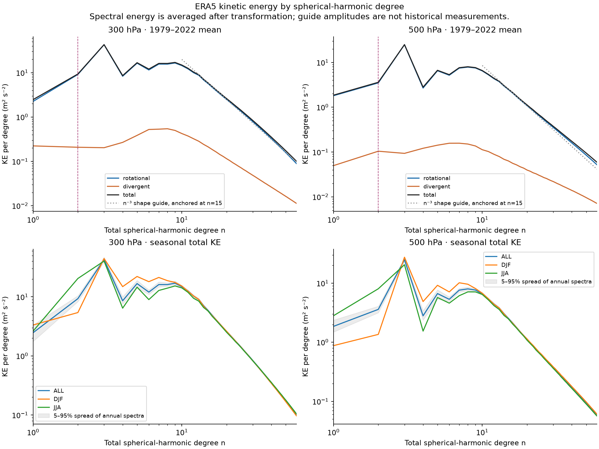
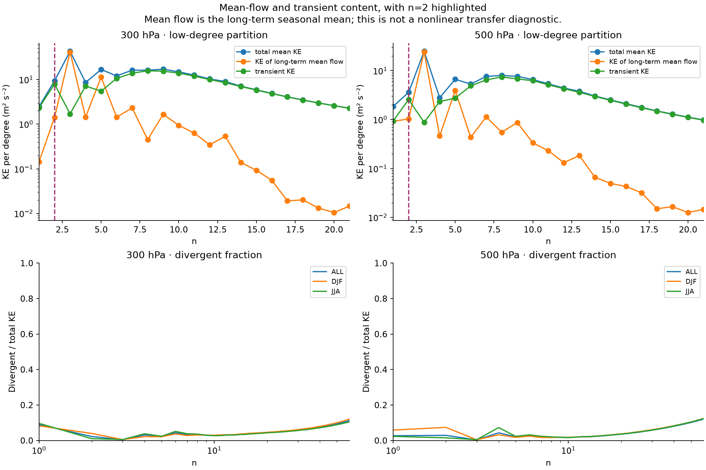
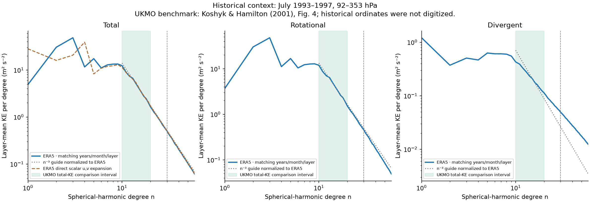

# Kinetic-energy content versus spherical-harmonic degree

This companion analysis was added at the user’s request. It measures energy distribution and historical spectral shape; it does not measure nonlinear energy flux.

## ERA5 results

| Level | Season | Degree range | Total-KE slope | 95% year-bootstrap interval |
|---|---|---|---:|---|
| 300 hPa | ALL | 10–20 | -2.589 | [-2.602, -2.575] |
| 300 hPa | ALL | 13–40 | -2.852 | [-2.860, -2.844] |
| 300 hPa | DJF | 10–20 | -2.605 | [-2.626, -2.582] |
| 300 hPa | DJF | 13–40 | -2.863 | [-2.875, -2.851] |
| 300 hPa | JJA | 10–20 | -2.533 | [-2.553, -2.514] |
| 300 hPa | JJA | 13–40 | -2.800 | [-2.809, -2.792] |
| 500 hPa | ALL | 10–20 | -2.590 | [-2.603, -2.576] |
| 500 hPa | ALL | 13–40 | -2.729 | [-2.736, -2.722] |
| 500 hPa | DJF | 10–20 | -2.609 | [-2.631, -2.585] |
| 500 hPa | DJF | 13–40 | -2.688 | [-2.697, -2.678] |
| 500 hPa | JJA | 10–20 | -2.571 | [-2.595, -2.550] |
| 500 hPa | JJA | 13–40 | -2.736 | [-2.747, -2.726] |

Bootstrap intervals resample the 44 complete calendar-year spectra (1,000 replicates). They describe year-to-year sampling variability; reanalysis, resolution and spectral-model uncertainty are additional. See energy_degree_spectra.csv for numerical spectra.

| Level | Season | E₁ | E₂ | E₃ | n=2 below both neighbors? | n=2 mean-flow fraction | n=2 divergent fraction |
|---|---|---:|---:|---:|---|---:|---:|
| 300 | ALL | 2.471 | 9.317 | 42.840 | False | 15.2% | 2.2% |
| 300 | DJF | 3.334 | 5.416 | 44.456 | False | 76.8% | 4.0% |
| 300 | JJA | 2.628 | 20.437 | 40.304 | False | 94.1% | 1.0% |
| 500 | ALL | 1.856 | 3.593 | 24.903 | False | 28.6% | 2.9% |
| 500 | DJF | 0.876 | 1.357 | 27.424 | False | 53.6% | 7.4% |
| 500 | JJA | 2.810 | 8.022 | 20.469 | False | 92.8% | 1.5% |

Energies are m² s⁻² per degree, summed over all orders. Mean-flow energy is the energy of the long-term coefficient mean over the stated months. Transient energy is the remaining mean energy, not a frequency-filtered wave band.

## Historical comparisons

| Benchmark | Published observation | Comparison and limits |
|---|---|---|
| [Boer & Shepherd (1983)](https://journals.ametsoc.org/view/journals/atsc/40/1/1520-0469_1983_040_0164_lstdti_2_0_co_2.xml) | FGGE spectra distinguish a stationary, seasonally sensitive low-degree regime from a more transient high-degree regime. | Compare the low-degree partition and January/winter versus July/summer behavior qualitatively. Our seasonal 44-year means and pressure-level sampling differ; no original FGGE ordinates were recovered. |
| [Nastrom & Gage (1985)](https://doi.org/10.1175/1520-0469(1985)042%3C0950:ACOAWS%3E2.0.CO;2) | Aircraft along-track spectra approach −3 at large scales and −5/3 below approximately 300–400 km. | Compare resolved synoptic-range shape. Along-track spectra differ from global degree spectra; amplitudes are not directly equated. |
| [Koshyk & Hamilton (2001), Fig. 4](https://www.gfdl.noaa.gov/bibliography/related_files/koshyk0101.pdf) | UKMO assimilated winds: five Julys, 1993–1997; 92–353 hPa; T30. Approximate −3 total-KE behavior at n=10–20, with a steeper drop beyond n≈20. | ERA5 uses matching years, month and approximate layer, at 00/12 UTC. The original vertical discretization is not replicated. Published digital ordinates were not retrieved, so reference lines are slope guides normalized to ERA5, not historical measured amplitudes. |

The ERA5 matched-window n=10–20 slopes are: vector_total: -2.836, rotational: -2.880, divergent: -2.004, scalar_uv_total: -2.729.

The scalar u,v expansion and vector/vorticity-divergence spectrum assign energy differently among the lowest degrees. Their distinction is particularly important when discussing n=2 (see the appendix of Koshyk & Hamilton). The physical energy definition used for the project is the vector one.

## Resolved scales and interpretation

With n≤59, the shortest nominal wavelength 2πa/n is about 678 km. The aircraft mesoscale −5/3 range is outside this dataset’s resolved range; the analysis cannot test that transition. Conservative regridding may affect the upper part of the retained spectrum. A −3 slope alone does not establish an enstrophy cascade, and neither a low-degree minimum nor a mean-flow fraction establishes condensation.

The strict individual-coefficient resolution check remains failed as documented in STAGE1_REPORT.md. All energy comparisons are descriptive. Raw historical amplitudes were not digitized; the comparison supplies published shape/scale benchmarks and a matched ERA5 sample, rather than an amplitude validation.
