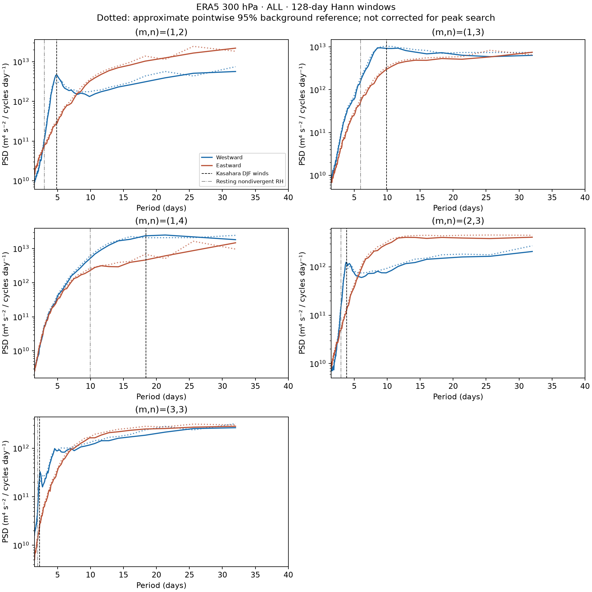

# Stage 1 — ERA5 comparison to Madden (2007)

Status: **REVIEW REQUIRED**. No Stage 2 computation is enabled.

Analysis job: 2085898. 64284 six-hourly samples, 1979–2022.
DJF 300 hPa superrotation ω = 3.61609e-07 s⁻¹; expected-positive check: True.

## Primary 300 hPa, all-season spectrum

| (m,n) | Expected (d) | Peak in target band (d) | Peak/background | West/east at peak | Above pointwise reference |
|---|---:|---:|---:|---:|---|
| (1,2) | 5 | 4.923 | 1.691 | 16.500 | True |
| (1,3) | 10 | 9.143 | 1.031 | 3.920 | False |
| (1,4) | 16 | 18.286 | 1.265 | 5.131 | True |
| (2,3) | 4 | 3.765 | 1.532 | 11.299 | True |
| (3,3) | 2 | 2.169 | 1.152 | 9.743 | True |

## Numerical checks

Synthetic suite: see synthetic-tests.txt. Energy closure passed: True; maximum relative error 9.05e-16.
Whole-field resolution L2 <1%: True. All individual degrees <1%: False. The strict resolution criterion is therefore NOT satisfied.
Maximum individual target-mode resolution difference over sampled dates: 7.91%. Small-amplitude modes amplify relative error. See resolution_detail.json and resolution_year.json for absolute errors and the full-year sensitivity check.

## Seasonal and height comparison

| (m,n) | 300 DJF peak/background | 300 JJA | 500 ALL |
|---|---:|---:|---:|
| (1,2) | 1.465 | 1.413 | 1.676 |
| (1,3) | 1.124 | 1.105 | 1.052 |
| (1,4) | 0.566 | 1.107 | 1.158 |
| (2,3) | 1.821 | 1.490 | 1.554 |
| (3,3) | 1.143 | 1.614 | 1.350 |

Seasonal comparisons use 64-day windows entirely within each season; all-season windows are 128 days. Their resolutions differ. Full values and eastward comparisons are in summary.json.

## Interpretation limits

These are target-band maxima, not automatically identified independent wave detections. The fitted running-median background and approximate χ² bounds are exploratory pointwise references: background uncertainty, correlated frequency bins and the search over periods are not calibrated. No overall statistical pass is assigned. Inspect wave shapes, eastward spectra and EOF-pair coherence before drawing conclusions.

Madden used a different reanalysis, period and spectral estimator. EOF files contain all 66 pairs for each m, ordered by variance; pair identification against Hough structures remains a scientific review step. See ../docs/methods.md.

Numerical and resolution checks are recorded separately in data_checks.json and synthetic-tests.txt. Job timings and frozen environment are retained alongside the report.
