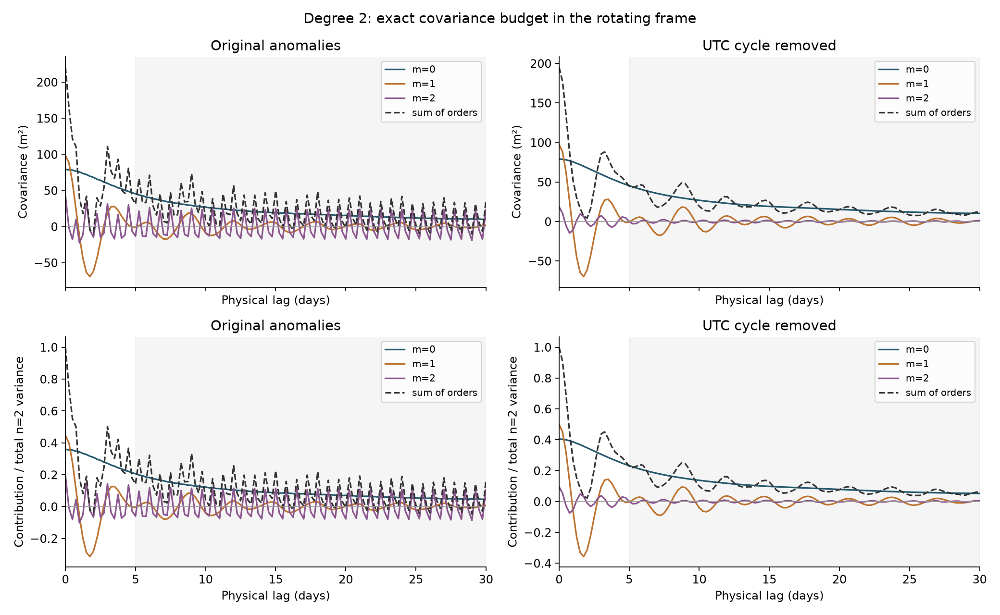
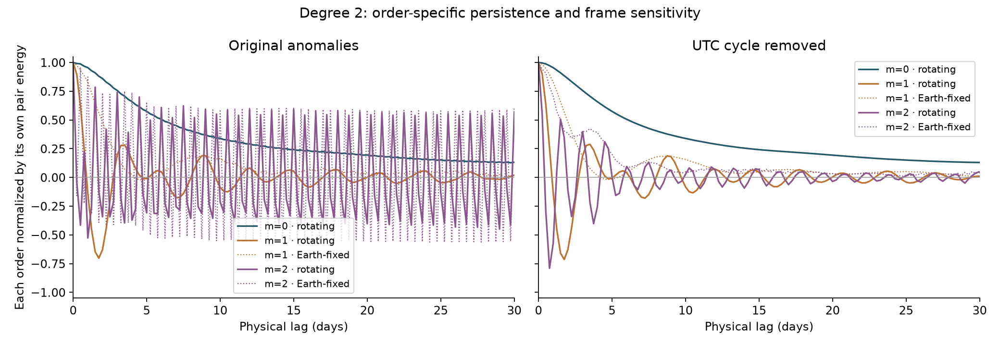
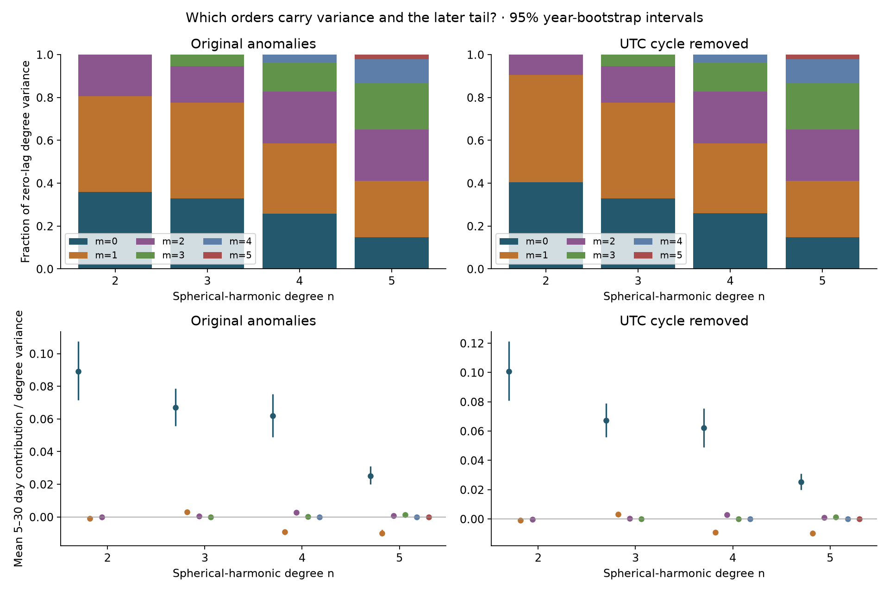
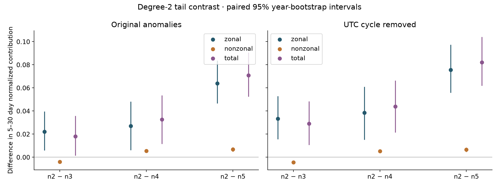

# Degree-2 memory: the later tail is zonal

**The order-by-order decomposition identifies the positive 5–30-day degree-2 tail with m=0, the zonally symmetric height component.** The nonzonal orders make a small negative signed contribution in that window. This holds with and without the repeating UTC cycle removed and in both 22-year halves.

The result sharpens the earlier interpretation: degree 2 carries a relatively large fraction of slowly varying zonal height variance. Its zonal component has a persistence timescale similar to degrees 3 and 4. We have evidence for a stronger degree-normalized later tail under this specified measure, but not for a uniquely slow degree-2 lifetime or a special propagating-wave memory mode.

## An exact covariance budget

All values below use 500 hPa height anomalies over 1979–2022 in the theoretical rotating frame. Covariances are area-mean contributions in m². The original mean and four annual harmonics have already been removed; “original anomalies” does not mean raw climatological height.

The fixed primary tail window is physical lags 5–30 days. No time exponent is fitted. Dividing every order by the same total-degree zero-lag variance makes the contributions add exactly. This avoids comparing curves whose denominators change when m=0 is excluded.

| Component of n=2 | Original variance fraction | Original tail covariance (m²) | UTC-removed variance fraction | UTC-removed tail covariance (m²) |
|---|---:|---:|---:|---:|
| m=0 | 35.9% | +19.6524 | 40.5% | +19.6523 |
| m=1 | 44.7% | −0.1809 | 50.0% | −0.1738 |
| m=2 | 19.4% | −0.0002 | 9.5% | −0.0360 |

After UTC-cycle removal, the zonal contribution divided by total degree-2 variance is **+0.1007** (95% whole-year bootstrap interval **+0.0809 to +0.1213**). The combined nonzonal contribution is **−0.00107** (interval **−0.00156 to −0.00068**), giving a total of **+0.09959**. The zonal contribution slightly exceeds the net tail because the nonzonal terms subtract from it; an ordinary percentage-share description would obscure this cancellation.

The zonal unnormalized covariance is essentially unchanged by removing the UTC cycle. Its increased normalized contribution largely reflects the smaller total variance denominator, especially the reduction of the m=2 variance. The time-of-day correction does not create the slow zonal covariance.

## Is the zonal component itself unusually slow?

| Degree | Zonal variance fraction, UTC removed | Zonal first 1/e crossing | Zonal mean own correlation, 5–30 days |
|---|---:|---:|---:|
| 2 | 40.5% | 9.04 days | 0.249 |
| 3 | 33.0% | 9.02 days | 0.206 |
| 4 | 25.9% | 9.42 days | 0.239 |
| 5 | 14.8% | 7.56 days | 0.170 |

Degree 2's zonal initial decay is comparable to degrees 3 and 4; it is not the slowest of these components. Its absolute zonal tail covariance, 19.65 m², is also below degree 3 (22.15 m²) and degree 4 (31.32 m²). The larger degree-normalized tail depends on the variance partition, not simply a uniquely long lifetime or a uniquely large absolute covariance.

The m=0 contribution is unchanged by longitude-frame rotation. The nonzonal curves oscillate, and their small signed averages do not mean there is no wave variability or no coherence at individual lags. The original m=2 curve contains particularly strong repeating time-of-day variability.

## What the degree comparisons establish

Under the specified 5–30-day, fixed-variance measure, degree 2 has a larger total normalized tail than degrees 3, 4 and 5. With the UTC cycle removed, paired differences are:

| Comparison | Difference in total normalized tail | Paired 95% interval |
|---|---:|---:|
| n=2 minus n=3 | +0.0291 | +0.0106 to +0.0483 |
| n=2 minus n=4 | +0.0438 | +0.0214 to +0.0663 |
| n=2 minus n=5 | +0.0822 | +0.0620 to +0.1040 |

The corresponding original-anomaly differences are also positive, with intervals excluding zero in this exploratory comparison. Most of the contrast comes from the zonal contribution. Nonzonal degree 2 lies below nonzonal degree 3; its positive differences relative to degrees 4 and 5 reflect less-negative signed tails, not a positive nonzonal tail of its own.

These findings do not contradict the earlier 0–10-day rescaled-curve test: the time window, normalization and reference definition differ. The earlier test and its uncertainty remain unchanged. This follow-up was motivated by inspecting those results, so its intervals are descriptive rather than a separately confirmed universal law.

## Robustness and limits

The UTC-removed zonal contribution is +0.0990 in 1979–2000 and +0.1024 in 2001–2022; combined nonzonal contributions remain small and negative. The 10–30-day sensitivity has the same qualitative attribution. Over 2–10 days the nonzonal average is slightly positive (+0.00514), but the zonal term is much larger (+0.2178). Thus the attribution is stable across these windows while the sign of the small nonzonal term is window-dependent.

The calculations reproduce every earlier n=2–5 all-order and nonzonal correlation, in both frames and both preprocessing variants, to a maximum absolute difference of **8.88×10⁻¹⁶**. Two new decomposition tests plus six existing memory tests passed on Unity (**8 tests**). Job **2096906** completed successfully.

The 400 paired year-bootstrap draws keep the climatology and UTC correction fixed. They do not account for reanalysis systematics, interannual dependence or multiple comparisons. Full-record anomalies retain possible trends and variations slower than a year; this decomposition alone does not separate those from intraseasonal zonal variability. It identifies which spherical-harmonic component supplies covariance, without establishing a dynamical cause, nonlinear-transfer mechanism or forecast skill.

The scientific target is now more specific: understand the slowly varying zonal height contribution and its variance partition across low degrees. The present results do not support treating the entire n=2 degree as one unusually persistent propagating mode.

[Specification](../../docs/order_memory_approach.md) · [Generated numerical report](REPORT.md) · [All order metrics and window sensitivities](order_metrics.csv) · [Time halves](time_halves.csv) · [Numerical curves](order_curves.nc) · [Annual products](annual_products.nc) · [Paired bootstrap draws](paired_bootstrap_contributions.npy) · [Summary](summary.json) · [Tests](tests.txt)
