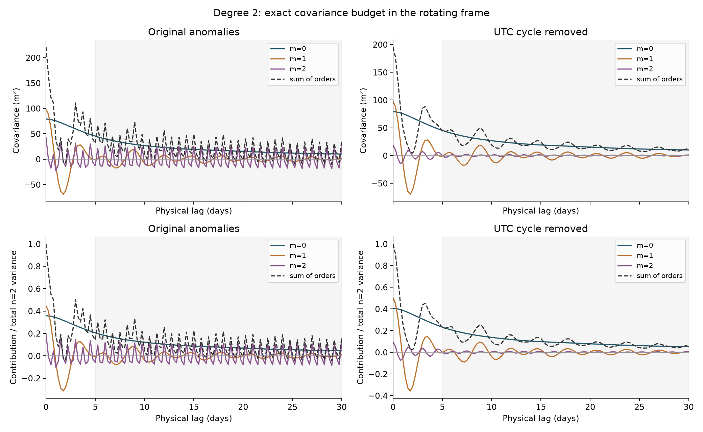
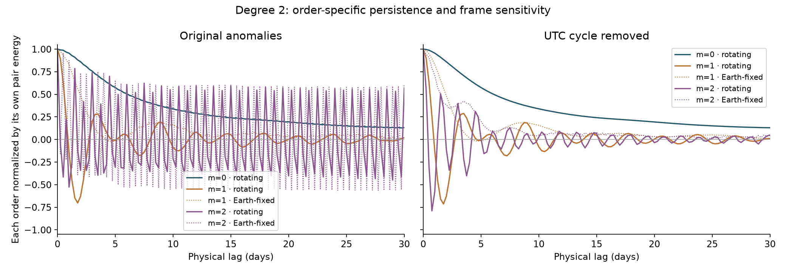
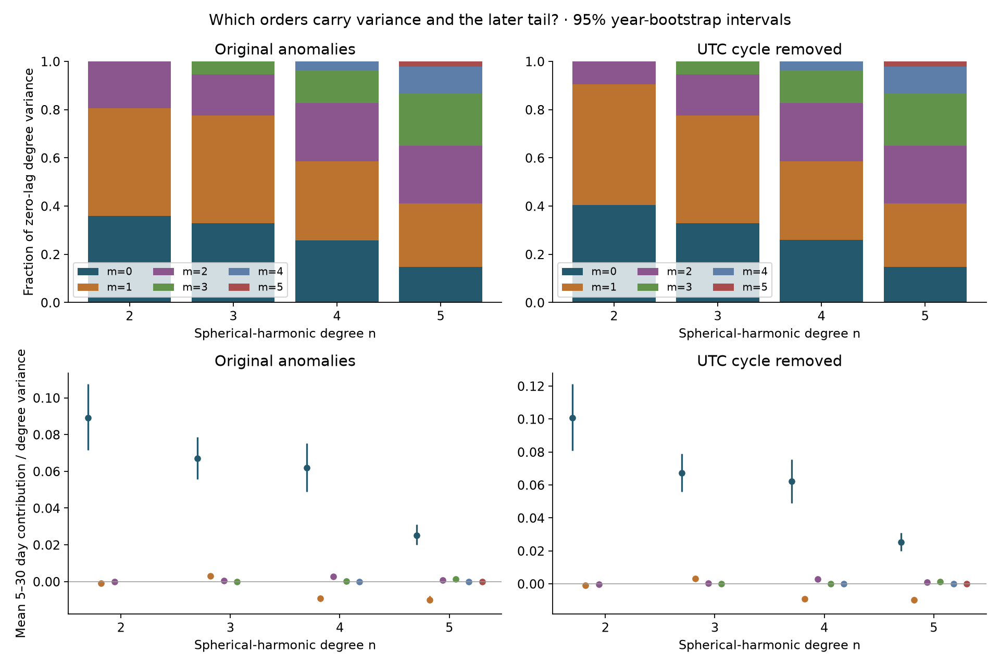
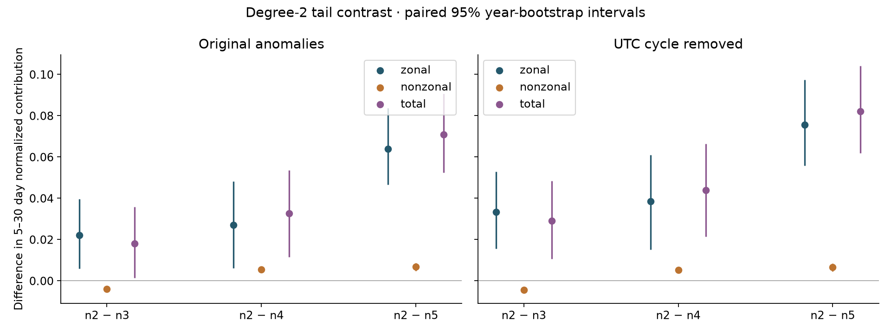

# Order-resolved atmospheric memory

Completed on Unity, job 2096906. Height anomalies, 500 hPa, 1979–2022.

No time scaling is fitted here. The primary later-tail window is fixed at physical lags 5–30 days. Components are summed under a common total-degree variance denominator; the previous all-order and nonzonal curves reconstruct to a maximum absolute error of 8.88e-16.

| Data | Order m | Variance fraction | Tail covariance (m²) | Contribution / total variance | 95% interval | Own normalized tail |
|---|---:|---:|---:|---:|---|---:|
| anomalies | 0 | 0.3590 | 19.6524 | 0.0891 | [0.0716, 0.1075] | 0.2485 |
| anomalies | 1 | 0.4465 | -0.1809 | -0.0008 | [-0.0012, -0.0005] | -0.0018 |
| anomalies | 2 | 0.1945 | -0.0002 | -0.0000 | [-0.0000, 0.0000] | -0.0000 |
| utc_cycle_removed | 0 | 0.4048 | 19.6523 | 0.1007 | [0.0809, 0.1213] | 0.2491 |
| utc_cycle_removed | 1 | 0.5001 | -0.1738 | -0.0009 | [-0.0014, -0.0005] | -0.0018 |
| utc_cycle_removed | 2 | 0.0952 | -0.0360 | -0.0002 | [-0.0002, -0.0002] | -0.0019 |

Intervals are paired whole-year bootstrap intervals with climatology and UTC correction held fixed. Negative contributions are retained. Products use full-record anomalies and are not re-centered separately at each lag or year. No causal mechanism or forecast skill is inferred.

[Specification](../../docs/order_memory_approach.md) · [All metrics and window sensitivities](order_metrics.csv) · [Time halves](time_halves.csv) · [Numerical curves](order_curves.nc) · [Annual products](annual_products.nc) · [Summary and paired contrasts](summary.json)
