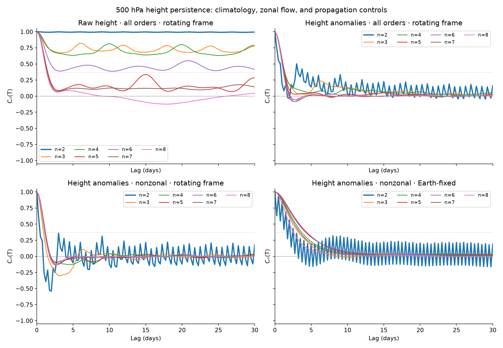
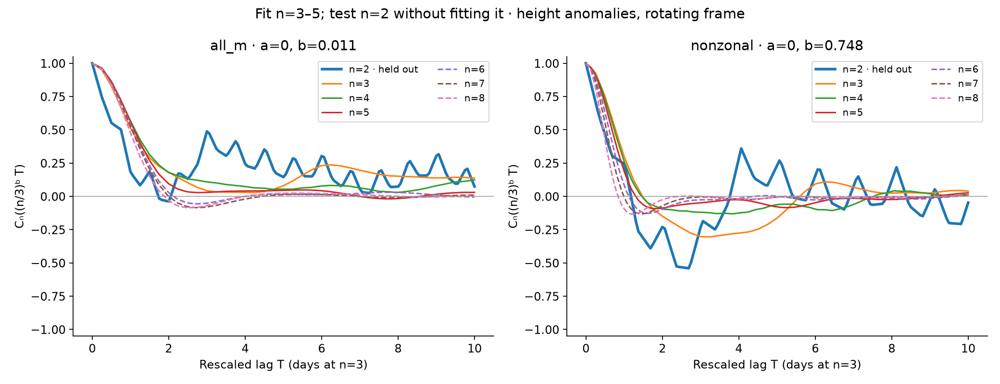
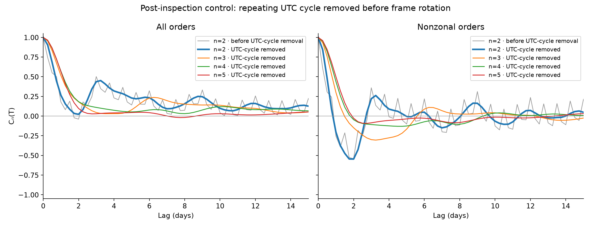
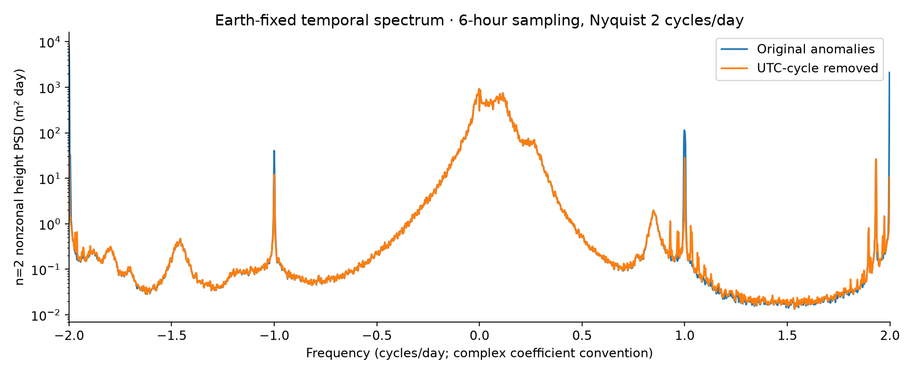

# Atmospheric memory: findings from the revised approach

The 500 hPa height analysis requested in the 21 November note is complete on Unity. **The results do not establish uniformly exceptional degree-2 memory.** The primary all-order excess interval includes zero, and the nonzonal comparison is negative. A subsequent time-of-day sensitivity reveals a positive all-order tail, so the answer depends on which components and which measure of memory are used.

## What changed

We extracted actual geopotential height for all 64,284 six-hourly ERA5 samples in 1979–2022. For each degree, we computed the global area-weighted correlation in the proposed Rossby–Haurwitz rotating frame, with Earth-fixed results as a control. Degrees 3–5 set the scaling; degree 2 was held out. Since Cₙ(0)=1, the primary amplitude exponent is a=0. Raw height, anomalies, seasonal subsets, time splits, detrending, nonzonal orders and rotational streamfunction remain separate comparisons.

The note's equations define a hypothesis to test. The ideal single-degree rotation law is not an exact theorem for observed atmospheric height. A fit with free amplitude is retained as a secondary relaxation, rather than silently violating the zero-lag normalization.

## Primary result, fixed before inspection

These are annual-harmonic height anomalies in the theoretical rotating frame, fitted over rescaled lags 0–10 days. “Excess” is the signed average difference between held-out degree 2 and the degree-3 reference after scaling. Intervals are percentile intervals from 400 whole-year bootstrap samples, refitting b each time.

| Components | b | 95% interval for b | Degree-2 excess | 95% interval for excess |
|---|---:|---:|---:|---:|
| All orders, including zonal m=0 | 0.011 | −0.069 to 0.075 | +0.0143 | −0.0090 to +0.0345 |
| Nonzonal orders, m>0 | 0.748 | 0.547 to 0.839 | −0.0190 | −0.0223 to −0.0119 |

For all orders, time rescaling barely changes the mismatch: MSE 0.009779 versus 0.009781 without scaling. The nonzonal mismatch improves from 0.017741 to 0.014353, but the oscillatory curves do not demonstrate a universal collapse. Positive b in this convention means that higher degrees are evaluated at longer physical lags for the same scaled lag; it does not encode the proposed simple hierarchy of faster decay at higher degree.

Degree 2 first falls below 1/e at **0.854 days**, versus **1.298, 1.384 and 1.324 days** for degrees 3, 4 and 5. This initial decay is faster, even though a later positive tail can remain. Raw height is much more persistent, primarily reflecting climatology and zonal structure; it is not evidence by itself for anomalous wave memory.

The nonzonal excess changes sign in the shorter 5-day fitting-window sensitivity (+0.0098), compared with −0.0190 for the specified 10-day window and −0.0066 for 15 days. This dependence prevents a blanket rejection or confirmation of the hypothesis based on one scalar score. The time-split, broader-degree, seasonal and field-definition controls are retained in [summary.json](summary.json) and the [primary report](REPORT.md).

## Follow-up after inspecting rapid oscillations

The initial height curves showed a strong repeating time-of-day signal, also present in the Earth-fixed frame. We therefore added an explicitly **post-inspection sensitivity**, leaving the primary comparison above unchanged: remove each calendar month's mean UTC-hour departures from its monthly mean, using the full record, then repeat the same correlation and held-out fit.

This preserves monthly means and removes a repeating sampling-time cycle. It does not establish whether the signal is physical atmospheric tides, analysis effects, or a combination. Six-hour sampling cannot fully resolve semidiurnal phase.

| Components after UTC-cycle removal | b | Degree-2 excess | 95% interval for excess |
|---|---:|---:|---:|
| All orders | −0.009 | +0.0412 | +0.0187 to +0.0645 |
| Nonzonal orders | 0.748 | −0.0181 | −0.0244 to −0.0117 |

The removed cycle accounts for 11.5% of all-order degree-2 anomaly variance and 17.8% of nonzonal degree-2 variance. The positive all-order tail deserves follow-up, but it does not survive removal of zonal components under this metric. Degree-2 initial 1/e crossings remain short: 0.859 days for all orders and 0.573 days for nonzonal orders. This exploratory positive result is not an independent confirmation, a forecast-skill result, or a diagnosis of nonlinear energy transfer.

## Numerical checks and reproducibility

Five new primary tests passed: linear lag products without wraparound, the physical rotation sign, area-weighted Parseval correlation, a known scaling with degree 2 held out, and zonal invariance. One additional UTC-cycle test passed and confirms preservation of monthly means. The full 1979 1° height check gives a degree-2 coefficient relative difference of 0.0128% and a maximum absolute correlation difference of 0.0000528. This is a one-year height sensitivity; it neither proves full-record convergence nor reverses the earlier failed strict vorticity criterion.

All 44 extraction tasks, the fine-grid extraction, and analyses completed on Unity. Jobs: validation 2095601; annual array 2095747; fine grid 2095748; primary analysis 2095749; UTC sensitivity 2096100. [Accounting](job-accounting.tsv), [primary tests](synthetic-tests.txt), and [UTC test](utc-tests.txt) are retained.

Bootstrap intervals hold the fitted climatology fixed and do not calibrate interannual dependence, reanalysis systematics, or multiple comparisons. Correlations omit cross-year pairs and never concatenate disconnected seasons. No propagation-speed optimization or forecast experiment was performed.

[Revised method](../../docs/memory_approach.md) · [Method frozen at the primary run](method-at-run.md) · [Primary numerical correlations](correlations.nc) · [UTC-control numerical correlations](utc_control_correlations.nc) · [UTC summary](utc_control_summary.json) · [Extracted data release](https://github.com/npizzo/n2-era5-madden/releases/tag/v0.2-memory-analysis)

The primary source checksum refers to the method as it stood at execution; its exact content is preserved in method-at-run.md. UTC source hashes are recorded separately. The original user PDF is retained locally and is not distributed in the repository.
