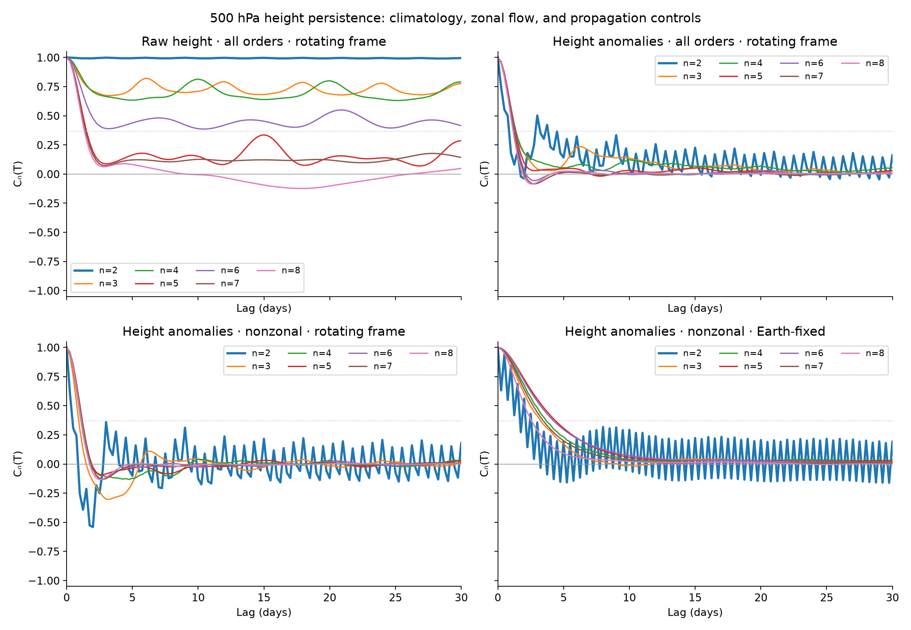
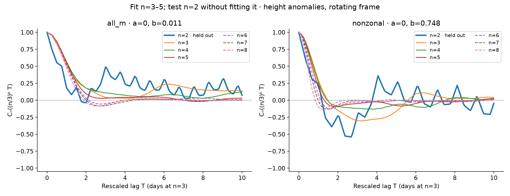
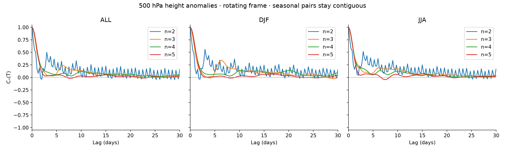
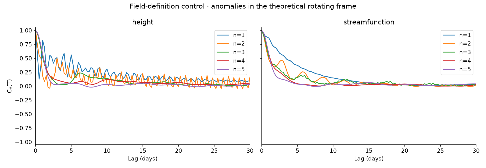

# Rotating-frame memory analysis — document follow-up

Status: **descriptive hypothesis test; scientific review required**.

500 hPa ERA5 height, 1979–2022; 64,284 six-hourly timestamps. Degrees 1–10 retained. The earlier vorticity-based analysis is a streamfunction control, not a substitute for height.

## Primary comparison

| Orders | a | b (n=3–5) | b bootstrap 95% interval | n=2 mean excess | Excess 95% interval | Collapse MSE | No-scaling MSE |
|---|---:|---:|---|---:|---|---:|---:|
| all_m | 0 | 0.011 | [-0.069212676546849, 0.07528892951483343] | 0.0143 | [-0.008961630899398181, 0.034547917924195946] | 0.00978 | 0.00978 |
| nonzonal | 0 | 0.748 | [0.547059885732185, 0.8394639606382245] | -0.0190 | [-0.022280893264287432, -0.01193969339992987] | 0.01435 | 0.01774 |

The primary data remove the mean and four annual harmonics. Degree 2 is excluded from fitting. The signed excess is the mean difference from the n=3 reference over rescaled lags 0–10 days, with n=3–5 defining b. Positive excess supports relative persistence only if the reference collapse is adequate. It is not proof of a unique atmospheric memory mode.

Normalized Cₙ(0)=1 forces a=0 for a collapse including zero lag. Free-a,b fits are retained as a secondary relaxation in summary.json. Scaling is written relative to n=3; this only changes the common coordinate/amplitude convention of nᵃCₙ(nᵇT).

## Persistence times

| n | First 1/e crossing (days) | First zero crossing (days) |
|---|---:|---:|
| 1 | 0.3701829028689488 | None |
| 2 | 0.8537418832803197 | 1.7236725905999974 |
| 3 | 1.2984316246811316 | 44.962291739884904 |
| 4 | 1.383720542367839 | None |
| 5 | 1.3243692201345627 | 7.040319665227569 |
| 6 | 1.2766649842448494 | 2.150268186302558 |
| 7 | 1.2407198737533898 | 2.0233722729540555 |
| 8 | 1.1654890805019744 | 1.9028696270283398 |
| 9 | 1.0843200898421146 | 1.8422877721333153 |
| 10 | 0.9954478967531873 | 1.832316335983079 |

Missing crossings mean none occurred within 60 days; no extrapolated lifetime is assigned. Oscillatory correlations are not forced to decay monotonically.

## Uncertainty and robustness

The 400-replicate bootstrap resamples whole calendar-year numerator/denominator contributions and refits b. Lags never cross year boundaries or disconnected seasonal segments. This preserves within-year lag dependence but omits cross-year pairs. DJF treats December and January–February as separate contiguous pieces within each calendar-year cluster. Climatology is fitted once to the full record, not refitted in every bootstrap. Interannual dependence and reanalysis uncertainty are not calibrated.

The summary retains fits over 5-, 10-, and 15-day rescaled windows (15 days uses b bounds constrained by available lags), reference degrees 3–8, raw/demeaned/anomaly controls, Earth-fixed and theoretical rotating frames, individual seasons, and 1979–2000 versus 2001–2022. Finite fit bounds and sparse low-degree reference curves limit scaling inference.

The one-degree 1979 extraction checks this new height analysis separately from the earlier failed vorticity coefficient criterion. See resolution_height.json; a one-year check cannot prove full-record convergence.

The Rossby–Haurwitz rotation law is exact for the ideal single-degree nondivergent barotropic problem. It is a hypothesis to test for observed geopotential height, which is not globally identical to streamfunction. Background winds, divergence, and baroclinic coupling can leave propagation in this frame.

[Revised approach](../../docs/memory_approach.md) · [Numerical correlations](correlations.nc) · [Fit and robustness results](summary.json) · [Synthetic tests](synthetic-tests.txt)
